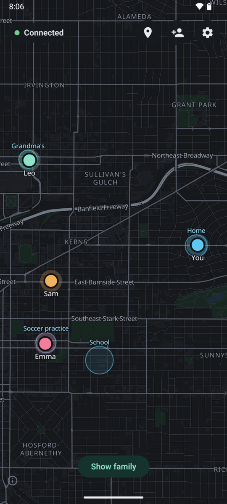
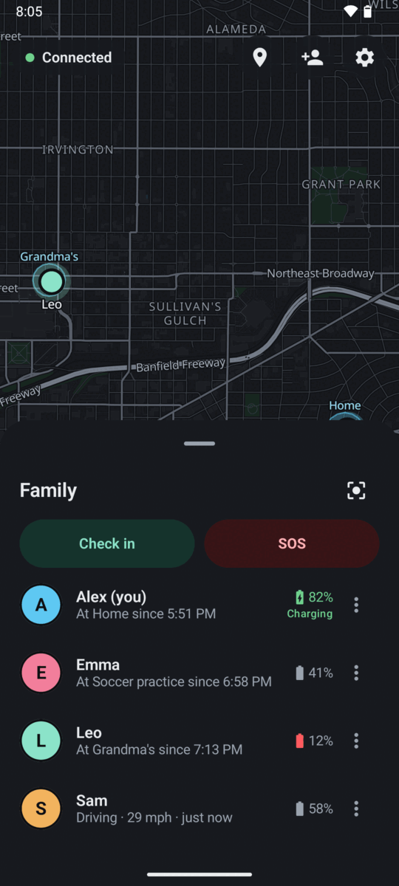
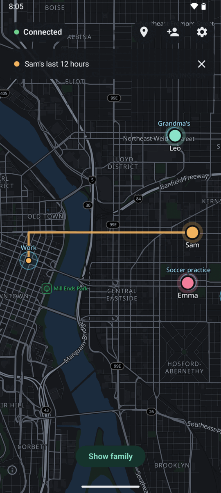
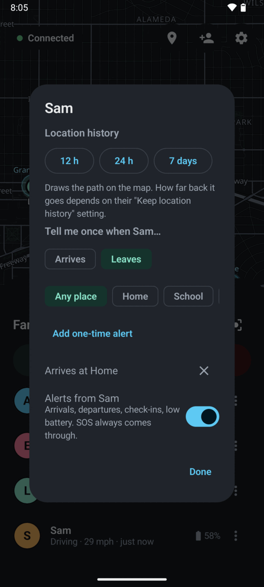
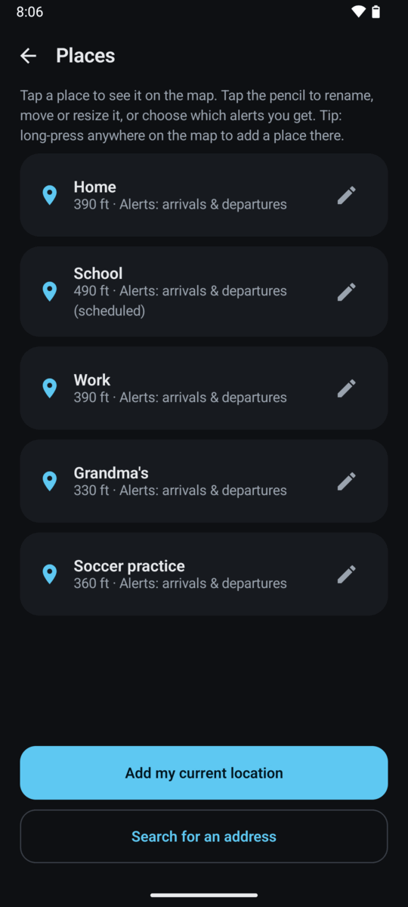
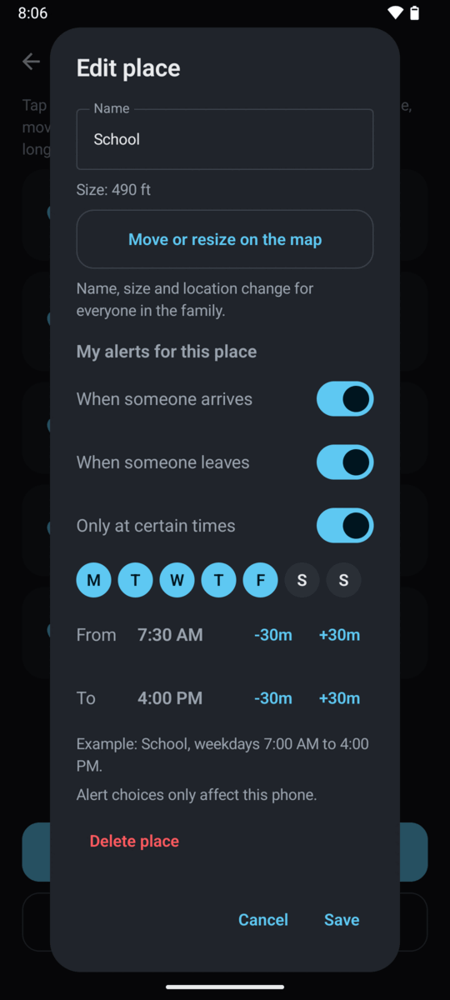
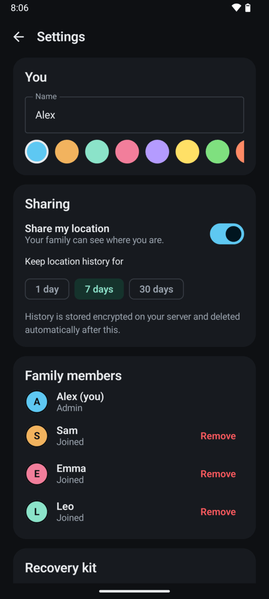

# Pod

**Pod Family Location** is a self-hosted, end-to-end encrypted family location sharing app for Android.
Your family's locations live on **your** server, and that server can't read them.

- **Your server, your data.** Runs on your own hardware with one `docker compose up`, reachable through a Cloudflare Tunnel (no open ports) or any HTTPS reverse proxy.
- **The server is blind.** Locations, names, places and alerts are encrypted on the phone. The server, your tunnel provider, and anyone who steals the database only ever see ciphertext.
- **No accounts.** No email, no passwords, no phone numbers. Family members join by scanning a QR code in person.
- **Your own map.** Map data © [OpenStreetMap contributors](https://www.openstreetmap.org/copyright), packaged by [Protomaps](https://protomaps.com) and drawn with [MapLibre](https://maplibre.org), all served from your own server. See [Credits](#credits).
- **Built to just work.** Survives reboots, app updates, flaky networks and aggressive battery savers, tells people plainly when something is off, and updates itself from your server.

<p align="center">
  
  
  
  
</p>
<p align="center">
  
  
  
</p>
<p align="center"><sub>Screenshots use made-up demo data.</sub></p>

**Features:** live family map · places with arrive/leave alerts (per-place schedules, one-time alerts, quiet hours) · SOS · check-in · battery and charging · driving speed and follow-while-driving · location history with auto-delete · "At Home since 3:12 PM" · low-battery and "hasn't updated" warnings · pause sharing (always visible to the family) · invite/remove members with automatic key rotation · encrypted recovery kit · in-app updates from your own server · dark map themes.

## How the privacy works

Each phone creates its own keys. The family admin's phone hands a shared family key only to phones that prove they scanned an invite QR in person, and changes the key whenever someone leaves or joins. Every message is encrypted with XChaCha20-Poly1305 and signed by its sender, so members can't impersonate each other and the server can't read or alter anything. Details: [docs/DESIGN.md](docs/DESIGN.md) (architecture and threat model) and [docs/PROTOCOL.md](docs/PROTOCOL.md) (wire format).

### What other services see
Being honest about the edges:
- **Cloudflare** (if you use the tunnel): phone IP addresses, connection timing, and which map areas are loaded. Never locations or names.
- **Address search** (optional, can be turned off): what you type plus a rough area (~11 km) goes to OpenStreetMap search services (Photon, Nominatim), and house-number searches to the US Census geocoder.
- **Google Play services** provides battery-friendly location on the phone. Pod falls back to Android's own location service on phones without it.

## Repository layout

```
server/    Go server: a blind relay for encrypted messages (SQLite)
deploy/    docker-compose (server + cloudflared), .env template, map setup script, map themes
android/   Android app (Kotlin, Jetpack Compose)
docs/      DESIGN.md, PROTOCOL.md, SELF-HOSTING.md
tools/     release publishing script
```

## What you need

- **A server**: any always-on Linux machine with Docker and Docker Compose (a mini PC, a Raspberry Pi 4/5, a Proxmox LXC or VM, a cheap VPS). About 1–2 GB of disk for a state-sized map.
- **A way to reach it over HTTPS**: a domain on Cloudflare (free plan) for the built-in Cloudflare Tunnel, or your own reverse proxy with a valid certificate. The app only talks HTTPS.
- **A computer to build the app**: Windows, macOS or Linux with [Android Studio](https://developer.android.com/studio) (it bundles the JDK 17 and Android SDK the build needs). Command-line builds work too with JDK 17 and the Android SDK command-line tools.
- **Android phones** running Android 8.0 or newer.

There is no prebuilt APK. Every family builds its own app, signed with its own key, so updates can only come from you.

## 1. Set up the server

Full guide, including Cloudflare settings, backups and troubleshooting: **[docs/SELF-HOSTING.md](docs/SELF-HOSTING.md)**.

```bash
git clone https://github.com/ToxicOrca/Pod.git
cd Pod/deploy
cp .env.example .env      # set POD_PUBLIC_URL, POD_SETUP_TOKEN, CLOUDFLARE_TUNNEL_TOKEN
BBOX="..." ./setup-map.sh # download your region's map (min_lon,min_lat,max_lon,max_lat)
docker compose up -d --build
curl https://pod.example.com/healthz   # → {"ok":true,...}
```

Not using Cloudflare? See [Running behind your own reverse proxy](docs/SELF-HOSTING.md#running-behind-your-own-reverse-proxy).

## 2. Build the app yourself

### Get the code and open it

```bash
git clone https://github.com/ToxicOrca/Pod.git
```

Open the `android/` folder (not the repo root) in Android Studio and let Gradle sync. The first sync downloads Gradle and the libraries and can take a few minutes.

### Create your signing key (once, ever)

Android only installs an update if it's signed with the **same key** as the installed app. Make the key once, back it up somewhere safe (a password manager or an offline drive), and never lose it. If you lose it, every phone has to uninstall and re-join.

```bash
keytool -genkeypair -v -keystore pod-release.jks -alias pod \
  -keyalg RSA -keysize 4096 -validity 10000
```

`keytool` comes with the JDK. In Android Studio's terminal it's already on the path; otherwise it's in Android Studio's `jbr/bin` folder. Alternatively use Android Studio's **Build → Generate Signed App Bundle / APK → Create new…** to make the key, then cancel the wizard. Keep the `.jks` file **outside** the repo.

### Choose your app ID (once, ever)

The app ID (like `com.example.yourname.pod`) is how Android tells apps apart. Phones only accept updates with the same ID, so pick it before anyone installs the app and never change it. The default is `app.podfamily.location`; using your own avoids clashing with anyone else's build.

### Fill in `keystore.properties`

```bash
cd android
cp keystore.properties.example keystore.properties
```

Edit `android/keystore.properties`:

```properties
# Full path, with forward slashes even on Windows (e.g. D:/keys/pod-release.jks)
storeFile=/full/path/to/pod-release.jks
storePassword=your-keystore-password
keyAlias=pod
keyPassword=your-key-password
# Optional: your own app ID (see above). Leave launcherName as is.
applicationId=com.example.yourname.pod
launcherName=.Launcher
```

Comments must be on their own line (`.properties` files don't allow comments after a value). This file is gitignored. Never commit it or the `.jks`.

### Build

From Android Studio's terminal (or any terminal in `android/`):

```bash
./gradlew assembleRelease        # Windows: gradlew.bat assembleRelease
```

The signed APK lands in `android/app/build/outputs/apk/release/app-release.apk`. If you get `app-release-unsigned.apk` instead, `keystore.properties` wasn't found or has no `storeFile`. A wrong password fails the build with a keystore error.

To check it's signed with your key: `apksigner verify --print-certs app-release.apk` (`apksigner` is in the SDK's `build-tools/<version>/` folder).

### Install it on phones

Pick one:

- **From your server (easiest for family):** publish the APK (see [Publishing updates](#publishing-updates) below), then open `https://your-server/download` in the phone's browser. This link always points to the newest version, so it's the one to text to relatives.
- **Over USB:** turn on Developer options → USB debugging, plug the phone in, then `adb install app-release.apk` (`adb` is in the SDK's `platform-tools`).
- **Copy the file:** send the APK to the phone any way you like and tap it.

The first install from outside the Play Store shows a few prompts. That's normal for any app not from the Play Store:
1. "Allow from this source": allow the browser or file manager to install apps.
2. **Google Play Protect** may say it doesn't recognize the app. Tap **More details → Install anyway**. It may ask to scan the app; either choice is fine.

Later updates go through the app's own updater and only show Android's normal "Update" confirmation.

### Create your family

Open Pod on your phone → **Start a new family** → enter your server address, the setup code (`POD_SETUP_TOKEN`) and your name. Go through the permission steps (**Allow all the time** for location, **Unrestricted** battery). Then, for each family member: install Pod on their phone → **Join my family**, tap the invite button on your phone and let them scan the QR code. Their phone is approved within a few seconds.

## Publishing updates

Phones update themselves from your server with no re-setup. For each release:

1. Bump `versionCode` (+1, it must always go up) and `versionName` in `android/app/build.gradle.kts`.
2. Build the release APK as above.
3. Put it on the server's `deploy/app/` folder with a `latest.json` next to it.

**On Windows**, the script does steps 2–3 for you (build, checks, upload over SSH or to a local folder):

```powershell
Copy-Item tools\publish.config.example.ps1 tools\publish.config.ps1   # once, then fill it in
.\tools\publish-release.ps1 -Notes "What changed"
```

**Anywhere else**, by hand. The APK must be named `pod-<versionName>.apk`:

```bash
cp android/app/build/outputs/apk/release/app-release.apk pod-1.2.3.apk
sha256sum pod-1.2.3.apk        # macOS: shasum -a 256 pod-1.2.3.apk
```

Create `latest.json` (plain UTF-8, no BOM):

```json
{
  "versionCode": 16,
  "versionName": "1.2.3",
  "notes": "What changed",
  "apk": "pod-1.2.3.apk",
  "sha256": "<the hash from sha256sum, lowercase hex>"
}
```

Copy **the APK first, then `latest.json`**, into `deploy/app/` on the server (for example with `scp`). No restart is needed. Check with `curl https://your-server/app/latest.json`.

The app checks when it's opened and every few hours in the background. Before installing, it verifies the file's hash, that it's a newer version with the same app ID, and that it's signed with the same key as the installed app, then hands it to Android's installer.

## Development

```bash
cd server && go test -race ./...            # server tests (Go 1.24+, needs a C compiler for SQLite)
cd android && ./gradlew testDebugUnitTest   # crypto, place tracking and location unit tests
```

Debug builds install alongside the release app (the app ID gets a `.debug` suffix) and are signed with a debug key, so they can't update a release install.

**Screenshots:** debug builds include a demo family (made-up people and places, never saved or synced). Run a Pod server locally with the demo city's map (`./setup-map.sh` with no BBOX), install a debug build on an emulator, then `adb shell am start -n app.podfamily.location.debug/app.podfamily.DemoActivity --es server http://10.0.2.2:8080`. See `android/app/src/debug/`.

Contributor notes and the rules every change must follow are in [CLAUDE.md](CLAUDE.md).

### A note on Android developer verification

Google has announced that, starting in 2026–2027 depending on the country, certified Android phones will only install apps from registered developers, including apps installed outside the Play Store. Google has said there will be options for hobbyists and for people installing their own builds, but the details are still changing. If this affects installs in your country, check Google's current [developer verification](https://developer.android.com/developer-verification) guidance.

## Status

Beta. Android only; iOS options are discussed in [docs/DESIGN.md](docs/DESIGN.md#roadmap). Known limitations are listed in the threat model.

## Security

Please report vulnerabilities privately: see [SECURITY.md](SECURITY.md).

## Credits

Pod stands on the shoulders of these projects and services. Thank you.

**Maps**
- Map data © [OpenStreetMap contributors](https://www.openstreetmap.org/copyright), available under the [Open Database License](https://opendatacommons.org/licenses/odbl/). The app shows this credit on the map (the ⓘ button).
- [Protomaps](https://protomaps.com): the free OpenStreetMap basemap builds, map styles and the PMTiles format that let Pod serve its own map with no map provider.
- [MapLibre](https://maplibre.org): the open-source map renderer.
- [Noto](https://fonts.google.com/noto) fonts for map labels (SIL Open Font License).

**Address search** (optional)
- [Photon](https://photon.komoot.io) by komoot and [Nominatim](https://nominatim.org), both built on OpenStreetMap data.
- The [US Census Bureau Geocoder](https://geocoding.geo.census.gov) for house addresses.

**Libraries**
- [Google Tink](https://github.com/tink-crypto) (encryption), [OkHttp](https://square.github.io/okhttp/), [Kotlin and kotlinx](https://kotlinlang.org), [Android Jetpack](https://developer.android.com/jetpack), [ZXing](https://github.com/zxing/zxing) and [zxing-android-embedded](https://github.com/journeyapps/zxing-android-embedded) (QR codes), [go-sqlite3](https://github.com/mattn/go-sqlite3) and [SQLite](https://sqlite.org).

Full license texts are in the app under Settings → Open-source licenses.

## License

[GNU Affero General Public License v3.0](LICENSE). If you run a modified version for others, you must share your changes. Third-party components and their licenses are listed in the app under Settings → Open-source licenses.
